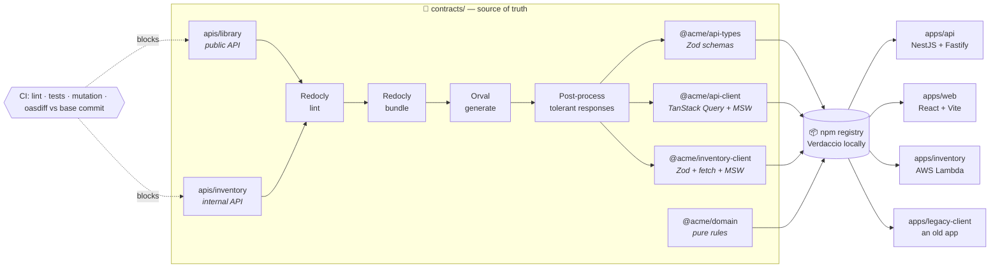
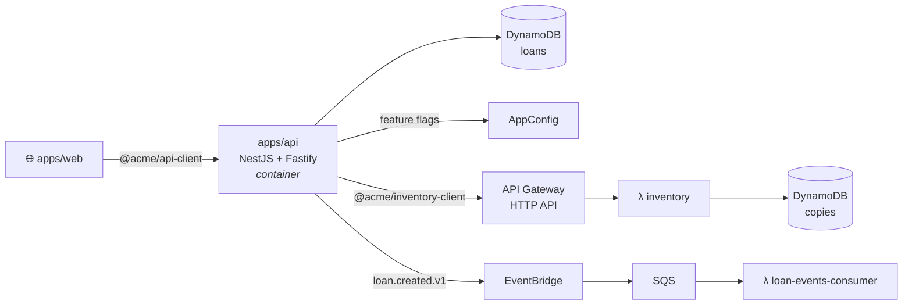
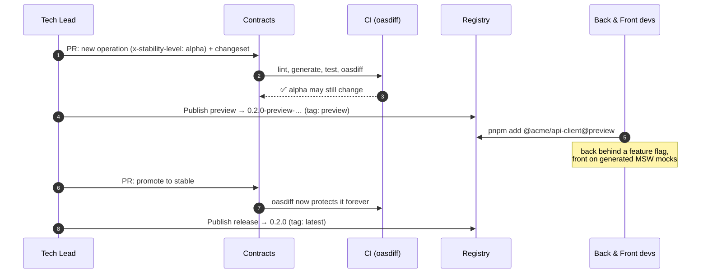
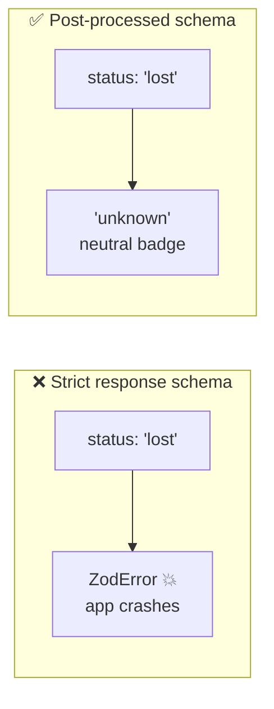
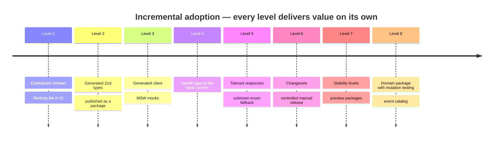

<div align="center">

# 📜 Contract-First POC

**The OpenAPI contract becomes code.**
One source of truth generates versioned packages (types, validation, HTTP client, mocks), and CI
blocks incompatible changes by machine, not by intuition.

[](./LICENSE)


[Why](#-why) •
[Architecture](#-architecture) •
[How it flows](#-how-a-change-flows) •
[Stack](#-tech-stack) •
[Getting started](#-getting-started) •
[Docs](#-documentation) •
[Roadmap](#-roadmap)

</div>

---

> [!NOTE]
> This is a **generic proof of concept** built for an engineering knowledge-transfer session. The
> domain is a fictional library (`books`, `loans`) and the npm scope is `@acme`. No real company,
> product or personal data is used anywhere.

## 🤔 Why

Many teams already do "API-first", but only halfway: there is an `openapi.yaml`, yet it is just
documentation. Every repository (backend, web, mobile, BFF) rewrites its own types, validation,
HTTP clients and mocks, and nothing checks whether a change breaks existing clients.

| Pain                           | Day-to-day symptom                                                                         | Fixed here by                          |
| ------------------------------ | ------------------------------------------------------------------------------------------ | -------------------------------------- |
| 🔀 **Contract drift**          | The YAML says `string`, the backend returns `number`, the frontend typed `string \| null`. | Code generated from a single contract  |
| 📋 **Duplicated work**         | N repositories writing the same types and validations.                                     | Published `@acme/*` packages           |
| 💥 **Silent client breakage**  | Renaming a field or adding an enum value takes down an old mobile app.                     | `oasdiff` in CI + tolerant responses   |
| ⏳ **Front blocked by back**   | The frontend waits for the endpoint to exist in staging.                                   | Generated MSW mocks from day one       |
| 🧩 **Inconsistent validation** | Zod here, Joi there, nothing elsewhere.                                                    | Generated Zod schemas, strict requests |
| 🚨 **Heterogeneous errors**    | Every service invents its own error format.                                                | RFC 9457 Problem Details everywhere    |
| 🏷️ **Informal versioning**     | "Which API version does app 3.2 use?"                                                      | Changesets, changelogs and dist-tags   |

## 🏗️ Architecture



Two contracts live side by side and follow the same rules: the **public library API** (web →
backend) and the **internal inventory API** (backend → Lambda). Contract-first is not only for
frontends: the backend is a consumer too.

### The published packages

| Package                  | What it contains                                                  | Consumed by          | Versioning                          |
| ------------------------ | ----------------------------------------------------------------- | -------------------- | ----------------------------------- |
| `@acme/api-types`        | Generated **Zod** schemas: runtime validation + inferred TS types | Backend and frontend | Fixed group with `api-client`       |
| `@acme/api-client`       | Generated **TanStack Query** hooks + **MSW** handlers (`/mocks`)  | Frontends            | Fixed group with `api-types`        |
| `@acme/inventory-client` | Generated **Zod** schemas, **fetch** client + **MSW** handlers    | Backend              | Independent (follows inventory API) |
| `@acme/domain`           | Pure, shared business rules (no I/O, 100% mutation score)         | Backend and frontend | Independent                         |

### Runtime on (emulated) AWS

The NestJS backend runs as a container. The inventory service is **Lambda only**: the backend
calls it over HTTP with the generated client. Locally, AWS is emulated by
[MiniStack](https://github.com/ministackorg/ministack) and provisioned with Terraform.



When a loan is created, the backend reserves a copy synchronously and announces the loan
asynchronously:


## 🔄 How a change flows

The contract is ready **before** the sprint. Stability levels (`draft` → `alpha` → `beta` →
`stable`) let it keep changing during the sprint without breaking anyone, and preview packages
never touch the `latest` dist-tag.



### Strict requests, tolerant responses

Old clients survive additive changes: unknown fields are dropped and unknown enum values become
`'unknown'` instead of a parse error.



## 🧰 Tech stack

| Area            | Tools                                                                         |
| --------------- | ----------------------------------------------------------------------------- |
| Monorepo        | Nx 24, pnpm 12 workspaces, Node.js 24 LTS, TypeScript 6 (strict)              |
| Contract        | OpenAPI 3.1, Redocly CLI (lint + bundle), Scalar (API reference portal)       |
| Code generation | Orval → Zod 4, TanStack Query 5, MSW; TypeScript compiler API post-processing |
| Backend         | NestJS 11 on Fastify (container), DynamoDB, AppConfig, EventBridge            |
| Serverless      | AWS Lambda (inventory service, event consumer), API Gateway HTTP API, SQS     |
| Frontend        | React 19, Vite, TanStack Query, MSW                                           |
| Quality         | ESLint (module boundaries), Prettier, Jest, Stryker, Playwright               |
| Compatibility   | oasdiff against the exact base commit, `x-stability-level`                    |
| Release         | Changesets (fixed groups, snapshot previews), Verdaccio                       |
| Infrastructure  | Docker Compose, MiniStack, Terraform                                          |
| CI              | GitHub Actions pinned by commit SHA                                           |

## 🚀 Getting started

> [!WARNING]
> The project is being built step by step. The commands below describe the target experience and
> become available as the [roadmap](#-roadmap) progresses.

**Prerequisites:** [nvm](https://github.com/nvm-sh/nvm), Docker with Compose, and pnpm 12.

```bash
nvm use                # Node.js 24.22.2 from .nvmrc
pnpm install
pnpm nx run contracts:generate
pnpm nx run-many -t lint test typecheck
```

## 📂 Repository layout

```
contract-first-poc/
├── AGENTS.md            # rules for AI agents (CLAUDE.md imports it)
├── contracts/           # the "contracts repository"
│   ├── apis/            # library (public) and inventory (internal) OpenAPI contracts
│   ├── shared/          # components shared by every API (Problem Details, error responses)
│   ├── events/          # domain event catalog
│   └── packages/        # @acme/api-types · @acme/api-client · @acme/inventory-client · @acme/domain
├── apps/                # api (NestJS) · inventory (Lambda) · web (React) · legacy-client
├── infra/               # Terraform for the emulated AWS environment
├── demos/               # scripts for the live demo scenarios
└── docs/                # one document per piece + ADRs
```

> In real life, `contracts/` would be its own repository and the apps would install the packages
> from a private registry. The monorepo keeps the demo self-contained.

## 📚 Documentation

| Document                                 | What you will find                                 |
| ---------------------------------------- | -------------------------------------------------- |
| [Original specification](./docs/spec.md) | The brief that drove this POC                      |
| [Rules for AI agents](./AGENTS.md)       | Source of truth, compatibility rules, prohibitions |

More documents (one per piece, ADRs, FAQ, glossary and the presentation script) are added as each
step lands.

## 🗺️ Roadmap



- [x] Monorepo skeleton (Nx, pnpm, strict TypeScript, module boundaries, agent rules)
- [x] OpenAPI 3.1 contract
- [x] Redocly lint and bundle
- [ ] Orval code generation
- [ ] Tolerant-response post-processing
- [ ] `@acme/domain` with mutation testing
- [ ] `apps/api` (NestJS + Fastify)
- [ ] `apps/legacy-client`
- [ ] `apps/web` (React + MSW)
- [ ] oasdiff and stability levels
- [ ] Emulated AWS (MiniStack + Terraform) and domain events
- [ ] Changesets, Verdaccio and preview releases
- [ ] GitHub Actions workflows
- [ ] Live demo scripts
- [ ] Full documentation and ADRs

## 📄 License

[MIT](./LICENSE) © Caio Maciel
