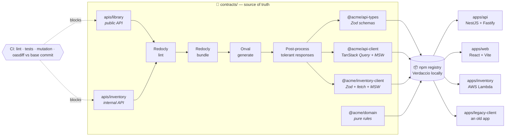
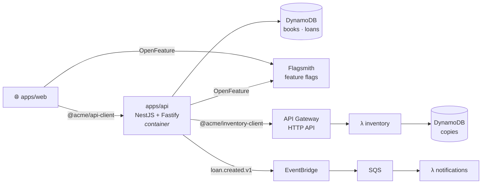
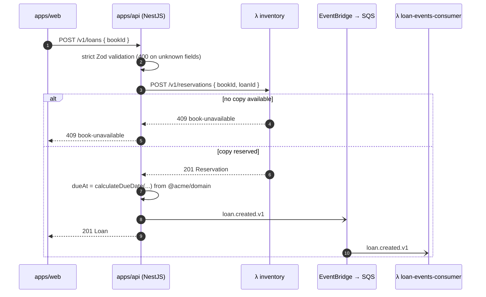
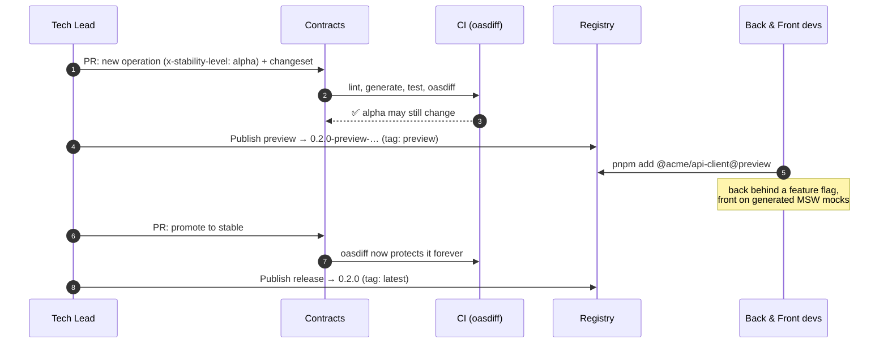
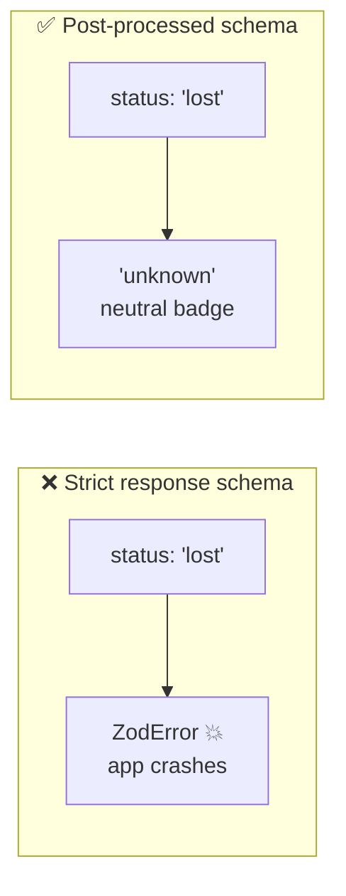
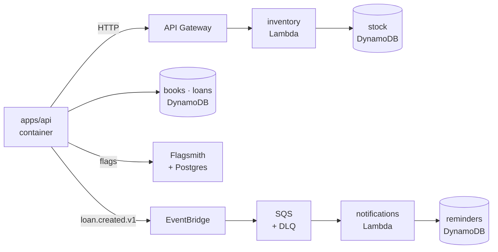
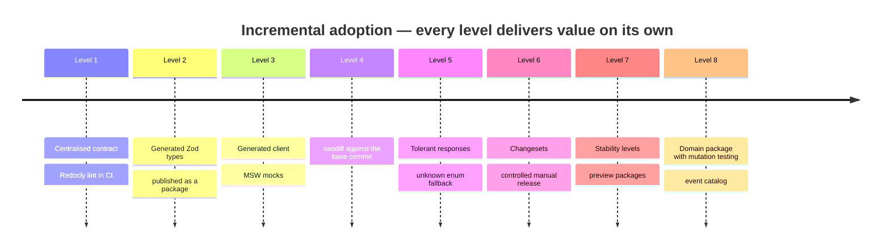

<div align="center">

# 📜 Contract-First POC

**The OpenAPI contract becomes code.**
One source of truth generates versioned packages (types, validation, HTTP client, mocks), and CI
blocks incompatible changes by machine, not by intuition.

[](https://github.com/M4ciel/contract-first-poc/actions/workflows/ci.yml)
[](./LICENSE)


[Why](#-why) •
[Architecture](#-architecture) •
[How it flows](#-how-a-change-flows) •
[Stack](#-tech-stack) •
[Getting started](#-getting-started) •
[Docs](#-documentation) •
[Roadmap](#-roadmap)

</div>

---

> [!NOTE]
> This is a **generic proof of concept** built for an engineering knowledge-transfer session. The
> domain is a fictional library (`books`, `loans`) and the npm scope is `@acme`. No real company,
> product or personal data is used anywhere.

## 🤔 Why

Many teams already do "API-first", but only halfway: there is an `openapi.yaml`, yet it is just
documentation. Every repository (backend, web, mobile, BFF) rewrites its own types, validation,
HTTP clients and mocks, and nothing checks whether a change breaks existing clients.

| Pain                           | Day-to-day symptom                                                                         | Fixed here by                           |
| ------------------------------ | ------------------------------------------------------------------------------------------ | --------------------------------------- |
| 🔀 **Contract drift**          | The YAML says `string`, the backend returns `number`, the frontend typed `string \| null`. | Code generated from a single contract   |
| 📋 **Duplicated work**         | N repositories writing the same types and validations.                                     | Published `@acme/*` packages            |
| 💥 **Silent client breakage**  | Renaming a field or adding an enum value takes down an old mobile app.                     | `oasdiff` in CI + tolerant responses    |
| ⏳ **Front blocked by back**   | The frontend waits for the endpoint to exist in staging.                                   | Generated MSW mocks from day one        |
| 🧩 **Inconsistent validation** | Zod here, Joi there, nothing elsewhere.                                                    | Generated Zod schemas, strict requests  |
| 🚨 **Heterogeneous errors**    | Every service invents its own error format.                                                | RFC 9457 Problem Details + type catalog |
| 🏷️ **Informal versioning**     | "Which API version does app 3.2 use?"                                                      | Changesets, changelogs and dist-tags    |

## 🏗️ Architecture



Two contracts live side by side and follow the same rules: the **public library API** (web →
backend) and the **internal inventory API** (backend → Lambda). Contract-first is not only for
frontends: the backend is a consumer too.

### The published packages

| Package                  | What it contains                                                                                                                          | Consumed by             | Versioning                          |
| ------------------------ | ----------------------------------------------------------------------------------------------------------------------------------------- | ----------------------- | ----------------------------------- |
| `@acme/api-types`        | Generated **Zod** schemas + inferred TS types; request validators (`/validators`)                                                         | Backend and frontend    | Fixed group with `api-client`       |
| `@acme/api-client`       | Generated **TanStack Query** hooks + **MSW** handlers (`/mocks`)                                                                          | Frontends               | Fixed group with `api-types`        |
| `@acme/inventory-client` | Generated **Zod** schemas, **fetch** client (base URL set at runtime), request validators (`/validators`) + **MSW** handlers              | Backend                 | Independent (follows inventory API) |
| `@acme/domain`           | Pure, shared business rules (no I/O, 100% mutation score)                                                                                 | Backend and frontend    | Independent                         |
| `@acme/events`           | Payload types + exact (producer) and tolerant (consumer) **Zod** schemas generated from the [event catalog](./contracts/events/README.md) | Producers and consumers | Independent                         |

### Runtime on (emulated) AWS

The NestJS backend runs as a container. The inventory service is **Lambda only**: the backend
calls it over HTTP with the generated client. Locally, AWS is emulated by
[MiniStack](https://github.com/ministackorg/ministack) and provisioned with Terraform.



When a loan is created, the backend reserves a copy synchronously and announces the loan
asynchronously:



## 🔄 How a change flows

The contract is ready **before** the sprint. Stability levels (`draft` → `alpha` → `beta` →
`stable`) let it keep changing during the sprint without breaking anyone, and preview packages
never touch the `latest` dist-tag.



### Strict requests, tolerant responses

Old clients survive additive changes: unknown fields are dropped and unknown enum values become
`'unknown'` instead of a parse error.



## 🧰 Tech stack

| Area            | Tools                                                                         |
| --------------- | ----------------------------------------------------------------------------- |
| Monorepo        | Nx 24, pnpm 12 workspaces, Node.js 24 LTS, TypeScript 6 (strict)              |
| Contract        | OpenAPI 3.1, Redocly CLI (lint + bundle), Scalar (API reference portal)       |
| Code generation | Orval → Zod 4, TanStack Query 5, MSW; TypeScript compiler API post-processing |
| Backend         | NestJS 11 on Fastify (container), DynamoDB, EventBridge                       |
| Feature flags   | Flagsmith (self-hosted, UI) read through OpenFeature in backend and frontend  |
| Serverless      | AWS Lambda (inventory service, event consumer), API Gateway HTTP API, SQS     |
| Frontend        | React 19, Vite, TanStack Query, MSW                                           |
| Quality         | ESLint (module boundaries), Prettier, Jest, Stryker, Playwright               |
| Compatibility   | oasdiff against the exact base commit, `x-stability-level`                    |
| Release         | Changesets (fixed groups, snapshot previews), Verdaccio                       |
| Infrastructure  | Docker Compose, MiniStack, Terraform                                          |
| CI              | GitHub Actions pinned by commit SHA                                           |

## 🚀 Getting started

**Prerequisites:** [nvm](https://github.com/nvm-sh/nvm), Docker with Compose, and pnpm 12.

```bash
nvm use                # Node.js 24.22.2 from .nvmrc
pnpm install
pnpm nx run contracts:generate
pnpm nx run-many -t lint test typecheck
pnpm nx run @acme/domain:mutation   # Stryker, fails below a 100% mutation score
pnpm nx run contracts:compat        # oasdiff vs the base commit (BASE_SHA, default: merge-base with main)
pnpm nx run @acme/tools:coverage    # every project's coverage added up, fails below 80%
pnpm nx run @acme/tools:clean-clone # fresh clone of HEAD: install, generate, test
pnpm nx run @acme/tools:changeset-check  # every affected published package has a changeset
pnpm nx run @acme/web:e2e           # Playwright (first time: pnpm --filter @acme/web exec playwright install chromium)
```

Run the frontend with no backend at all, on the contract's generated MSW handlers:

```bash
VITE_USE_MOCKS=true pnpm nx run @acme/web:serve   # http://localhost:4200
```

Mock mode never calls Flagsmith; turn a flag on with `VITE_FLAG_BOOKS_V2=true` to build a screen
for an alpha endpoint before the backend has it. Without `VITE_USE_MOCKS`, Vite forwards `/v1` and
`/v2` to `API_PROXY_TARGET` (default `http://localhost:3000`) and the app reads flags from
Flagsmith when `VITE_FLAGSMITH_ENVIRONMENT_KEY` is set (see `apps/web/.env.example`).

Run the whole backend locally, on emulated AWS:

```bash
pnpm nx run @acme/infra:up                        # builds the Lambdas, starts MiniStack, applies Terraform, starts the API
pnpm nx run @acme/infra:smoke                     # end-to-end checks (loans, inventory, events, flags)
pnpm nx run @acme/infra:flag --args="booksV2 on"  # or flip it in the Flagsmith UI; the API follows within seconds
pnpm nx run @acme/infra:down
```

| Service                   | URL                                                               |
| ------------------------- | ----------------------------------------------------------------- |
| Library API (NestJS)      | http://localhost:3000                                             |
| Inventory API (Lambda)    | http://localhost:4566/_aws/execute-api/inventory                  |
| MiniStack (AWS emulator)  | http://localhost:4566                                             |
| Flagsmith (feature flags) | http://localhost:8000 (`admin@example.test` / `acme-local-admin`) |
| Verdaccio (npm registry)  | http://localhost:4873                                             |

Every `up` resets MiniStack and applies Terraform from scratch: catalog and stock start from the
seed (`infra/terraform/seed/books.json`), with no loans, and the Flagsmith seed turns every flag
off. The credentials and keys are example values for this local environment only.

To see a flag change in the browser, run the web app against it and flip `booksV2` in the UI (the
catalog switches to the alpha v2 list on the next load):

```bash
VITE_FLAGSMITH_ENVIRONMENT_KEY=acmeLocalClientKey pnpm nx run @acme/web:serve
```



### Continuous integration

| Workflow                | When                         | What                                                                                                                                                                           |
| ----------------------- | ---------------------------- | ------------------------------------------------------------------------------------------------------------------------------------------------------------------------------ |
| `ci.yml`                | pull request, push to `main` | format, actionlint, contract lint, lint, typecheck, build, tests + global coverage, mutation, **oasdiff vs base commit**, changesets, Playwright, local environment smoke test |
| `changeset-version.yml` | push to `main`               | opens or updates the **Version PR** (bumps + changelogs); merging it publishes nothing                                                                                         |
| `release.yml`           | manual, `main` only          | tests and builds, then publishes to `latest`                                                                                                                                   |
| `preview.yml`           | manual, `main` only          | snapshot versions of pending changesets, guarded, published to `preview`                                                                                                       |

Every action is pinned by commit SHA. Release and preview share a concurrency group and, without
an `NPM_REGISTRY_URL` repository variable, publish to a disposable Verdaccio inside the job.

### Releases

Whoever changes a published package adds a changeset (`pnpm changeset`). Publishing is always a
manual step: a release goes to the `latest` dist-tag, and a **preview** of pending changes goes to
`preview` as a snapshot version (`0.2.0-preview-<datetime>`), without touching `latest`. Rehearse
both against the local Verdaccio:

```bash
pnpm nx run @acme/infra:up              # starts Verdaccio with the rest of the environment
pnpm nx run @acme/infra:release-local   # release + preview on a temporary clone, then a consumer install
```

```
@acme/api-types: latest: 0.1.0 preview: 0.2.0-preview-20261108041557
@acme/api-client: latest: 0.1.0 preview: 0.2.0-preview-20261108041557
```

Verdaccio stands in for the company's private registry; nothing leaves the machine.

## 📂 Repository layout

```
contract-first-poc/
├── AGENTS.md            # rules for AI agents (CLAUDE.md imports it)
├── contracts/           # the "contracts repository"
│   ├── apis/            # library (public) and inventory (internal) OpenAPI contracts
│   ├── shared/          # shared by every API: Problem Details, problem type catalog, errors
│   ├── events/          # domain event catalog: one folder per event, one schema per version
│   ├── tooling/         # generate (post-processing, events) · compat (oasdiff) · reference (portal)
│   └── packages/        # @acme/api-types · @acme/api-client · @acme/inventory-client · @acme/domain · @acme/events
├── apps/                # api (NestJS) · inventory and notifications (Lambdas) · web (React) · legacy-client
├── tools/               # repository-wide checks (global coverage, clean clone)
├── infra/               # Terraform for the emulated AWS environment
├── demos/               # scripts for the live demo scenarios
└── docs/                # one document per piece + ADRs
```

> In real life, `contracts/` would be its own repository and the apps would install the packages
> from a private registry. The monorepo keeps the demo self-contained.

## 📚 Documentation

| Document                                                 | What you will find                                                     |
| -------------------------------------------------------- | ---------------------------------------------------------------------- |
| [Documentation index](./docs/README.md)                  | One document per piece: pain, how it works, trade-offs, how to demo it |
| [Overview](./docs/00-overview.md)                        | The problem, the proposal and the architecture                         |
| [Tolerant responses](./docs/04-tolerant-responses.md)    | The subtlest piece: strict requests, tolerant responses                |
| [Compatibility rules](./docs/09-compatibility-rules.md)  | Change → breaking? → what to do, verified with oasdiff                 |
| [FAQ and gotchas](./docs/14-faq-and-gotchas.md)          | Objections and every non-obvious problem we hit                        |
| [Presentation script](./docs/presentation.md)            | A 40-minute session, slide by slide                                    |
| [Architecture decisions](./docs/adr/README.md)           | Twelve ADRs, deviations from the specification included                |
| [Live demos](./demos/README.md)                          | One script per scenario, each asserting its outcome                    |
| [Rules for AI agents](./AGENTS.md)                       | Source of truth, compatibility rules, prohibitions                     |
| [Implementation report](./docs/implementation-report.md) | Acceptance criteria, what was validated, deviations and their reasons  |
| [Original specification](./docs/spec.md)                 | The brief that drove this POC                                          |

The API reference portal (Scalar) is built from the bundles with
`pnpm nx run contracts:reference` into `contracts/artifacts/reference/index.html`.

## 🗺️ Roadmap



- [x] Monorepo skeleton (Nx, pnpm, strict TypeScript, module boundaries, agent rules)
- [x] OpenAPI 3.1 contract
- [x] Redocly lint and bundle
- [x] Orval code generation
- [x] Problem type catalog (`urn:acme:problem:*`, field-level validation errors)
- [x] Tolerant-response post-processing (TypeScript AST, unknown enum values become `unknown`)
- [x] `@acme/domain` with 100% coverage and mutation score (Stryker)
- [x] `apps/api` (NestJS + Fastify, contract validators, Problem Details, inventory over HTTP)
- [x] `apps/legacy-client` (frozen 1.0.0 schemas read responses of the current contract)
- [x] `apps/web` (React + MSW mock mode, neutral badge for `unknown`, Playwright)
- [x] Global coverage floor (80%) and clean-clone check
- [x] oasdiff against the exact base commit and `x-stability-level` behaviour tests
- [x] Inventory Lambda on emulated AWS (MiniStack, API Gateway, DynamoDB, Terraform) and Docker Compose
- [x] DynamoDB repositories and `loan.created.v1` (EventBridge → SQS → Lambda)
- [x] Feature flags in Flagsmith (UI) through OpenFeature, in the backend and the web app
- [x] Domain event catalog (`loan.created.v1` JSON Schema → `@acme/events`, immutability check)
- [x] Changesets (fixed `api-types` + `api-client`), snapshot previews and a local release to Verdaccio
- [x] GitHub Actions workflows (CI, Version PR, manual release and preview), actions pinned by SHA
- [x] Live demo scripts (`demos/`, each asserts its outcome; `bash demos/run-all.sh`)
- [x] Documentation (one document per piece), ADRs, presentation script, glossary and API reference portal
- [x] Implementation report (acceptance criteria, validations, deviations)

## 📄 License

[MIT](./LICENSE) © Caio Maciel
