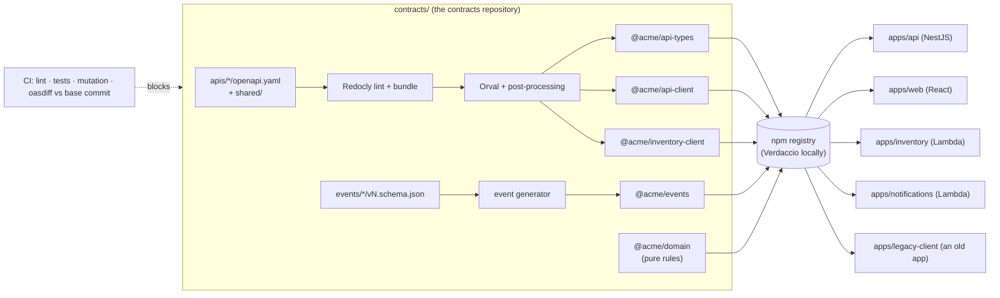
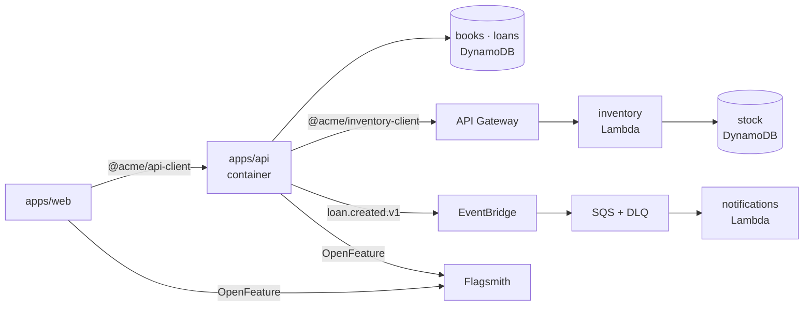

# Overview

## TL;DR

The HTTP API and the domain events are written **once**, as contracts. Everything that consumers
used to write by hand (types, validation, HTTP clients, mocks) is **generated** from them and
published as versioned packages, and CI proves on every pull request that a change does not break
anyone.

## What pain it solves

Today, a YAML file in a wiki describes the API, and every repository (backend, web, mobile, BFF)
rewrites its own types, validation schemas, HTTP clients and mocks. Nothing connects them:

- the backend renames `author` to `writer`, the web app still reads `author`, and the bug shows up
  in production;
- a new enum value (`status: 'lost'`) makes an app that users have not updated for months crash on
  a screen that worked yesterday;
- the frontend waits for the backend to start a feature, because there is nothing to call;
- "does this change break anyone?" is answered by intuition in code review.

## How it works



The fictional domain is a library: books, loans and copies. Two contracts follow the same rules:

- the **public library API** (web → backend): books, loans, a `/v2` in preview;
- the **internal inventory API** (backend → a Lambda that owns the physical copies). Service to
  service is the same problem as client to server, so it gets the same treatment.

The pieces, in the order a change flows through them:

1. [OpenAPI contract](./01-openapi-contract.md) and [lint](./02-lint-and-bundle.md): conventions
   are rules, not a wiki page.
2. [Code generation](./03-code-generation.md): types, Zod schemas, TanStack Query hooks, a fetch
   client and MSW mocks.
3. [Tolerant responses](./04-tolerant-responses.md): requests are strict, responses are tolerant,
   so old clients survive additive changes.
4. [Domain package](./05-domain-package.md): shared business rules with 100% mutation score.
5. [CI and compatibility](./06-ci-and-compatibility.md): oasdiff against the exact base commit.
6. [Versioning and release](./07-versioning-and-release.md) and
   [stability and preview](./08-stability-and-preview.md): Changesets, manual releases, snapshot
   previews of contracts that are still alpha.
7. [Events](./10-events.md): the same rigour for asynchronous messages.

At runtime ([details](./15-runtime-and-environment.md)), everything runs locally on emulated AWS:



## Day-to-day usage

```bash
nvm use && pnpm install
pnpm nx run contracts:generate                 # after any contract change
pnpm nx run-many -t lint test typecheck        # what CI runs, minus the slow parts
pnpm nx run contracts:compat                   # does this change break anyone?
pnpm changeset                                 # describe the change for consumers
```

## Trade-offs

Contract-first costs a contract pull request, a release and a version bump before code that uses a
new field can ship. [Stability levels and previews](./08-stability-and-preview.md) exist to make
that cost small during a sprint; [agile and trade-offs](./12-agile-and-trade-offs.md) lists the
rest and when the approach is not worth it.

## How to demonstrate

`bash demos/run-all.sh` runs the eleven [live demos](../demos/README.md). For a short session,
demos 3, 4 and 5 tell the whole story: an old client survives a new enum value, a breaking change
is blocked, and an alpha contract is previewed without touching `latest`.

## Frequently asked questions

See [FAQ and gotchas](./14-faq-and-gotchas.md) and the [glossary](./glossary.md).
