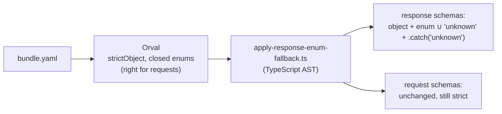

# Tolerant responses

## TL;DR

Requests are **strict** and responses are **tolerant**. After Orval generates the Zod schemas, a
script rewrites only the response schemas so that unknown fields are dropped and unknown enum
values become `'unknown'`. An app built months ago survives every additive change the backend is
allowed to make.

## What pain it solves

A mobile app that users have not updated for months parses responses with the schemas it shipped
with. Then the backend does two things the compatibility rules explicitly allow:

1. adds a field to a response: a strict schema throws `ZodError: Unrecognized key "renewals"`;
2. adds an enum value: `status: 'lost'` throws `ZodError: Invalid option`, and the screen is gone.

Neither is a bug in the backend, and the app cannot be fixed retroactively: the old build is
already on users' phones. The only place to fix it is the schemas the app shipped with.

## How it works

The principle is Postel's law: be strict in what you send, tolerant in what you receive.



`contracts/scripts/apply-response-enum-fallback-core.ts` (pure, 100% covered) does it in two
passes, on the AST and never with regular expressions:

1. **Find the response schemas.** It parses the generated client and collects the types inside
   `data` of every alias that has **both** `data` and `status` properties
   (`type getLoanResponse200 = { data: Loan; status: 200 }`). Requiring `status` matters: TanStack
   mutation variables (`{ data: CreateLoanRequest }`) also have `data` but describe a request.
   `Array<…>` is unwrapped, the `Output` suffix is stripped, and `ProblemDetails` is always
   included.
2. **Rewrite them** in the `*.zod.ts` files, only inside exported declarations with those names:
   - `zod.strictObject(…)` and `zod.looseObject(…)` become `zod.object(…)`, which accepts unknown
     keys and drops them from the parsed value;
   - every string `zod.enum([...])` that has no `.catch` yet gets `'unknown'` appended (when
     missing) and `.catch('unknown')` chained.

   Edits are applied back to front so positions stay valid. The generation **fails** if a response
   type has no matching schema, so a change in Orval's output cannot silently skip a schema.

The result, in the generated `@acme/api-types`:

```ts
export const Loan = zod.object({
  id: zod.uuid(),
  status: zod.enum(['active', 'returned', 'overdue', 'unknown']).catch('unknown'),
  // ...
});
```

The `unknown` value is part of the type (`LoanOutput['status']`), so the compiler makes every
`switch` on it handle the case. The web app shows a neutral "Status unavailable" badge; the problem
type catalog uses the same mechanism, so an unknown error type falls back to the server's `title`.

What stays strict:

- **request schemas and validators**: an extra field in a request is a client bug, rejected with a
  400 that points at it;
- **a response that really breaks the contract**: `dueAt: 'tomorrow'` still fails. Tolerance covers
  additive changes, not garbage.

The same script runs on the inventory API, so the backend survives additive changes to the Lambda
it calls.

## Day-to-day usage

Nothing to do: it runs inside `contracts:generate`. Consumers parse responses with the generated
schemas at the boundary:

```ts
// apps/web/src/api/api-result.ts (simplified)
export const toApiResult = <S extends z.ZodType>(
  schema: S,
  successStatus: number,
  response: RawResponse,
) =>
  response.status === successStatus
    ? { ok: true, value: schema.parse(response.data) }
    : {
        ok: false,
        problem: ProblemDetails.safeParse(response.data).data ?? unexpectedProblem(response.status),
      };
```

## Trade-offs

- **Coupled to Orval's output.** The core has 17 tests: `strictObject`/`looseObject` replaced, enum
  without `'unknown'`, enum that already has it, enum that already has `.catch`, request schemas
  untouched, nested schemas, quote style and the zod import name. An Orval upgrade that changes the
  shape fails them.
- **Silent `unknown`.** A typo in the server (`'actve'`) also becomes `unknown` instead of an error.
  The backend's own contract tests (`expectToMatchContract`) parse every response with the schemas
  and require nothing to be dropped, so the server cannot ship such a value unnoticed.
- **Dropped fields are invisible to old clients**, which is the point; a new client must upgrade
  the package to see them.
- Alternatives: `.passthrough()` keeps unknown fields (they leak into the app's state);
  `z.string()` for enums loses the type; hand-written tolerant schemas drift from the contract.

## How to demonstrate

[Demo 3](../demos/03-new-enum-value.sh) adds `lost` to `Loan.status`. oasdiff accepts it, the
legacy client (frozen on `@acme/api-types` 1.0.0, see `apps/legacy-client`) reads `unknown`, the
same schemas without post-processing throw `ZodError`, and 50 rounds of mocks generated from the
new contract parse.

## Frequently asked questions

**Why not `.catch` on the whole object?** It would hide real contract breaks. Only enums fall back,
and only to a value the type system knows.

**Does the backend get tolerant schemas too?** For what it receives from the inventory API, yes.
For what it receives from clients (requests), no: requests are strict.

**What about new required fields in a response?** They are additive for old clients (they drop
them). For new clients they are part of the contract from the version that added them.
