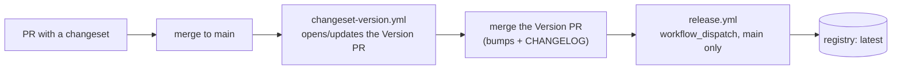

# Versioning and release

## TL;DR

Whoever changes a published package adds a **changeset** describing the change and its bump. A
bot keeps a **Version PR** with the bumps and changelogs; publishing is always a manual, explicit
step. Locally, a disposable Verdaccio stands in for the company's private registry.

## What pain it solves

Manual releases mean versions nobody can explain, no changelog, and `@acme/api-types` 1.4.0 next to
an `@acme/api-client` 1.3.0 whose types came from 1.4.0's predecessor.

## How it works

Published packages: `@acme/api-types`, `@acme/api-client`, `@acme/inventory-client`,
`@acme/domain`, `@acme/events`. The apps are private and never published.

`.changeset/config.json` (Changesets 3.0.3):

```json
{
  "access": "restricted",
  "commit": false,
  "fixed": [["@acme/api-types", "@acme/api-client"]],
  "privatePackages": { "version": false, "tag": false },
  "snapshot": { "useCalculatedVersion": true, "prereleaseTemplate": "{tag}-{datetime}" }
}
```

- **Fixed group:** `api-types` and `api-client` always share a version, because the client's types
  come from the types package; mismatched versions produce incompatible types.
- **Contract changes need changesets too.** The packages are generated from `contracts/`, so a
  YAML change changes a package without touching a file inside it. `changeset status` cannot see
  that; `nx run @acme/tools:changeset-check` maps changed paths to packages (library API →
  `api-types` + `api-client`, `shared/` → those and `inventory-client`, `events/` → `events`,
  the Orval config and the post-processing → the HTTP packages, the event generator → `events`)
  and fails when one has no changeset.



- `changeset-version.yml`: on every push to `main`, `changesets/action` opens or updates the
  **Version PR** (`chore(release): Version packages`). Merging it publishes nothing.
- `release.yml`: **manual only** (`workflow_dispatch` on `main`). Tests, typechecks and builds,
  then `changeset publish` to `latest`.
- `preview.yml`: manual too, see [stability and preview](./08-stability-and-preview.md). Both
  share the `publish` concurrency group, so they never publish at the same time.
- **Registry:** without an `NPM_REGISTRY_URL` repository variable, both workflows publish to a
  Verdaccio **service container inside the job**, which disappears with it: the whole flow can be
  shown without any company infrastructure. With the variable and an `NPM_TOKEN` secret, they
  publish to the real private registry. Authentication is one script for every case
  (`infra/scripts/registry-auth.sh`).

`workspace:*` dependencies between packages become real versions when pnpm packs them; the local
release checks it from a consumer's point of view.

## Day-to-day usage

```bash
pnpm changeset                              # pick packages and bump, describe the change
pnpm nx run @acme/tools:changeset-check     # what CI checks
pnpm nx run @acme/infra:up                  # Verdaccio (with the rest of the environment)
pnpm nx run @acme/infra:release-local       # release + preview on a temporary clone
```

`release-local` works on a temporary clone of HEAD (your tree never gets the bumps): version and
publish to `latest`, a snapshot preview to `preview`, the dist-tags, and a consumer that installs
the packages in an empty folder and uses them:

```
@acme/api-types: latest: 0.1.0 preview: 0.2.0-preview-20261108041557
@acme/api-client: latest: 0.1.0 preview: 0.2.0-preview-20261108041557
  imports work: status unknown | due 2026-01-24T12:00:00.000Z | loan.created.v1
  @acme/api-client depends on @acme/api-types 0.1.0 (workspace:* was replaced)
```

## Trade-offs

- A release is a deliberate act (merge the Version PR, then run `release.yml`). That is slower than
  publishing on merge, and on purpose: nothing reaches consumers by accident.
- Pull requests opened by `GITHUB_TOKEN` (the Version PR) do not trigger other workflows, so CI
  does not run on it. A GitHub App token would fix that; see [next steps](./next-steps.md).
- semantic-release was not chosen: it derives versions from commit messages, which describe the
  change for the repository's developers, not for the package's consumers.

## How to demonstrate

[Demo 5](../demos/05-preview-in-alpha.sh) publishes a preview to the local Verdaccio and shows
`npm dist-tag ls` with `latest` untouched. `pnpm nx run @acme/infra:release-local` runs a full
release and preview.

## Frequently asked questions

**Which bump?** Additive contract change → `minor`; a fix that changes no shape → `patch`; `major`
only for a new major API version or the removal of a deprecated operation. See
`.changeset/README.md`.

**Who triggers a release?** Whoever owns the contracts repository, after the Version PR is merged.
AI agents never do ([AGENTS.md](../AGENTS.md)).
