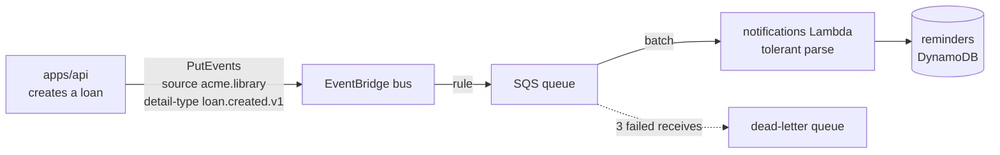

# Events

## TL;DR

Domain events are contracts too. Each one is a JSON Schema in `contracts/events/`, one folder
per event and one file per version (`loan.created/v1.schema.json`), **immutable** once published, with no personal data. `@acme/events` is generated
from it: payload types plus an exact schema for producers and a tolerant one for consumers.

## What pain it solves

Asynchronous messages drift like HTTP APIs, only more silently. A producer adds a field, renames
one, or changes a date format; the consumer fails at 3 a.m. in a queue nobody watches, and the
message ends up in a dead-letter queue weeks before anyone notices.

## How it works

```
contracts/events/
├── README.md                # the rules and what is not automated yet
├── asyncapi.yaml            # channels: where each event travels, who sends and who receives
└── loan.created/            # one folder per event (entity.action)
    ├── catalog-info.yaml    # owner and system (software catalog)
    └── v1.schema.json       # one JSON Schema 2020-12 per version
```

```json
{
  "$id": "urn:acme:event:loan.created.v1",
  "title": "loan.created.v1",
  "x-source": "acme.library",
  "type": "object",
  "additionalProperties": false,
  "required": ["loanId", "bookId", "startedAt", "dueAt"],
  "properties": { "loanId": { "type": "string", "format": "uuid" }, "...": {} }
}
```

`contracts/tooling/generate/generate-events.ts` (part of `contracts:generate`) checks every file against the
catalog rules (name, `$id`, `title`, `description`, `x-source`, `additionalProperties: false`, no
property name that usually carries personal data such as `email` or `phone`) and generates:

```ts
import {
  LOAN_CREATED_V1,
  LOAN_CREATED_V1_SOURCE,
  LoanCreatedV1,
  LoanCreatedV1Tolerant,
} from '@acme/events';
// LOAN_CREATED_V1 / _SOURCE  → EventBridge detail-type and source
// type LoanCreatedV1         → payload type (json-schema-to-typescript)
// LoanCreatedV1.parse(...)   → exact: producers' tests
// LoanCreatedV1Tolerant      → ignores unknown fields: consumers
```

The flow at runtime:



- The backend publishes after the loan is saved. A publishing failure is logged and does not fail
  the request (there is no outbox yet; see [next steps](./next-steps.md)).
- The notifications Lambda stores one return reminder per event, **idempotently** (keyed by the
  event id, so a redelivered message is stored once), and reports failed messages with
  `batchItemFailures`, so only those are retried and then dead-lettered.

Guarantees:

- **Producer exactness:** the backend's test parses what it publishes with `LoanCreatedV1` (exact).
- **Catalog consistency:** every schema validates its own `examples`, rejects an extra field
  (exact) and accepts it (tolerant).
- **Immutability:** `contracts:compat` fails when an event that exists at the base commit changes or
  disappears, and prints the diff. Events are matched by `$id`, so moving a file is not a removal. A
  new shape is a new file (`loan.created/v2.schema.json`), published side
  by side until every consumer moved.

**Channels:** `contracts/events/asyncapi.yaml` (AsyncAPI 3) describes where each event travels: the
EventBridge bus `acme-library` (operation `send`, by the library backend) and the SQS queue of each
consumer (operation `receive`), with two messages per event, because the shape changes on the way:

| Message                 | Where           | Shape                                                                          |
| ----------------------- | --------------- | ------------------------------------------------------------------------------ |
| `loanCreatedV1`         | bus (published) | the payload, with `source` and `detail-type` as headers                        |
| `loanCreatedV1Delivery` | queue (read)    | the EventBridge envelope (`id`, `source`, `detail-type`, `time`) with `detail` |

Both reference `loan.created/v1.schema.json`. Redocly lints the document with the HTTP contracts,
and a test fails when an event schema is not referenced by it.

**What is not automated yet:** channels are not diffed (no mature AsyncAPI equivalent of oasdiff), so
renaming a bus or a queue in the document is not blocked in CI.

## Day-to-day usage

1. Add `contracts/events/<entity>.<action>.v1.json` (approved by a human, like any contract).
2. `pnpm nx run contracts:generate`, then use `@acme/events` in the producer and the consumer.
3. `pnpm changeset` for `@acme/events`.

## Trade-offs

- Strict immutability means even a description fix needs a new version. That is deliberately
  simple: a rule with exceptions would need a tool to judge them.
- JSON Schema → Zod uses `z.fromJSONSchema`, which covers the keywords used here; exotic keywords
  would need checking.
- Events carry identifiers and dates only. A consumer that needs personal data looks it up behind
  access control, using a pseudonymous id.

## How to demonstrate

[Demo 10](../demos/10-event-immutable.sh) adds a required field to `loan.created.v1` and shows
`contracts:compat` failing. The environment's smoke test (`pnpm nx run @acme/infra:smoke`) checks
that a loan produces a reminder through EventBridge, SQS and the Lambda.

## Frequently asked questions

**Why not version the event inside the payload?** The name is the version: routing rules and
consumers subscribe to `loan.created.v1` explicitly and are never surprised by `v2`.
