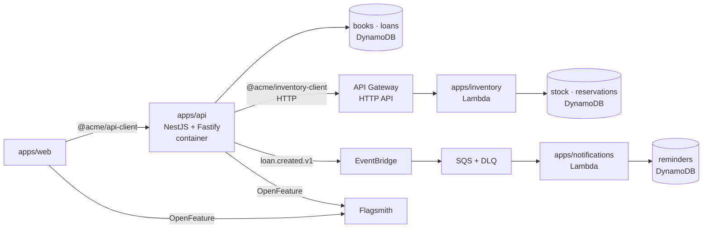

# Runtime and local environment

## TL;DR

The library backend is a NestJS container; the inventory service is a separate Lambda behind API
Gateway, called through its own generated client; loans announce themselves with an event consumed
by another Lambda. All of it runs locally on emulated AWS (MiniStack), provisioned by Terraform, with
one command.

## What pain it solves

Contracts only prove their value when real services use them. A POC that stops at generated types
cannot show a backend surviving a Lambda's additive change, or an event reaching a consumer.

## How it works



### `apps/api` (NestJS 11 on Fastify)

- Validates every request with the generated validators (`@acme/api-types/validators`) in a
  `ZodValidationPipe`; errors become Problem Details with a JSON Pointer per field.
- Answers with Problem Details from the shared catalog through one exception filter
  (`urn:acme:problem:internal` for anything unexpected, logged).
- Picks its adapters once, from the configuration: DynamoDB tables, the EventBridge bus and
  Flagsmith when they are configured, in-memory ones otherwise (tests, local development).
- Reserves a copy in the inventory service with a timeout; a 201 is parsed with the tolerant
  schema, a 404 becomes `book-not-found`, a 409 becomes `book-unavailable`, and anything else
  (other statuses, network errors, the timeout) becomes `service-unavailable` (503).
- Tests run the real application with `app.inject`, mock the inventory at the network level with
  its generated MSW handlers, and check every response with `expectToMatchContract` (the parsed
  value must equal the body: nothing dropped, nothing invented).

### `apps/inventory` (Lambda)

A plain TypeScript handler, no framework, behind an HTTP API. It validates with
`@acme/inventory-client/validators`, and reserves a copy in **one conditional DynamoDB
transaction** (`reservedCopies < totalCopies`), so the last copy can never be taken twice.
tsdown bundles it and the AWS SDK into a single `index.mjs`.

### `apps/notifications` (Lambda)

Consumes `loan.created.v1` from SQS ([events](./10-events.md)).

### Local environment

`compose.yaml`, every image pinned by digest:

| Service                     | What                                                                      |
| --------------------------- | ------------------------------------------------------------------------- |
| `ministack`                 | AWS emulator on `:4566` (Lambda, API Gateway, DynamoDB, EventBridge, SQS) |
| `infra`                     | one-shot Terraform job: resets MiniStack and applies `infra/terraform`    |
| `flagsmith`, `flagsmith-db` | feature flags with a UI on `:8000`                                        |
| `flagsmith-seed`            | one-shot: example admin password, fixed example keys, every flag off      |
| `api`                       | the backend image (`apps/api/Dockerfile`, production dependencies only)   |
| `verdaccio`                 | private npm registry stand-in on `:4873`                                  |

Terraform creates the Lambdas, the HTTP API (with a pinned id, so the URL is always
`/_aws/execute-api/inventory`), the tables seeded from `infra/terraform/seed/books.json` (the API's
in-memory catalog is checked against the same file), the bus, rule, queue and dead-letter queue.

## Day-to-day usage

```bash
pnpm nx run @acme/infra:up        # builds the Lambdas, starts everything, applies Terraform
pnpm nx run @acme/infra:smoke     # loans, inventory, events and flags, end to end
pnpm nx run @acme/infra:down
```

| URL                                              | What                                                                  |
| ------------------------------------------------ | --------------------------------------------------------------------- |
| http://localhost:3000                            | Library API                                                           |
| http://localhost:4566/_aws/execute-api/inventory | Inventory API (Lambda)                                                |
| http://localhost:8000                            | Flagsmith (`admin@example.test` / `acme-local-admin`, example values) |
| http://localhost:4873                            | Verdaccio                                                             |

Every `up` starts from the seed: no loans, every flag off.

## Trade-offs

- An emulator is not AWS: IAM is not enforced and some services are partial. It is good enough to
  prove the contracts and the wiring, not to test permissions.
- MiniStack was chosen over LocalStack for its size and start time
  ([ADR 0006](./adr/0006-emulated-aws-with-ministack.md)).
- The inventory service could have been a module of the backend. It is a separate service on
  purpose: service-to-service contracts are where compatibility matters most
  ([ADR 0007](./adr/0007-inventory-as-a-separate-service.md)).
- Events are published after the loan is saved, without an outbox: a crash between the two loses
  the event. See [next steps](./next-steps.md).

## How to demonstrate

- [Demo 8](../demos/08-strict-request.sh): a strict request rejected with a 400 Problem Details.
- [Demo 7](../demos/07-frontend-without-backend.sh): the web app with no backend.
- The smoke test shows a loan reserving a copy in the Lambda and producing a reminder.

## Frequently asked questions

**Does CI run this?** Yes, the "Local environment" job starts it and runs the smoke test on every
pull request.
