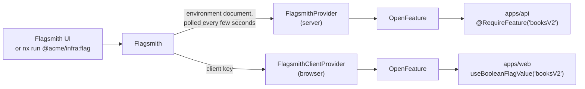

# Feature flags

## TL;DR

Operations below `stable` stay behind feature flags in production. Flags live in a self-hosted
Flagsmith (with a UI) and both the backend and the web app read them through **OpenFeature**, the
vendor-neutral standard, so moving to LaunchDarkly or another vendor means swapping a provider.

## What pain it solves

A preview contract must be usable by the teams building it and invisible to everyone else. Without
flags, the only switches are "deploy" and "do not deploy", and an alpha endpoint either blocks the
release or leaks into production.

## How it works



**Backend.** `FeatureFlags` has one implementation over OpenFeature; the configuration picks the
provider:

```ts
// apps/api/src/common/feature-flags.factory.ts (simplified)
export const createFlagProvider = (config: AppConfig): Provider =>
  config.featureFlags.source === 'flagsmith'
    ? new FlagsmithProvider(
        new Flagsmith({ apiUrl, environmentKey: serverKey, enableLocalEvaluation: true }),
      )
    : new InMemoryProvider(/* fixed values from FEATURE_* variables: tests, local development */);
```

- **Local evaluation:** the SDK downloads the environment once, polls it (every 3 seconds locally)
  and evaluates in memory, so a flag check never waits for the network.
- `@RequireFeature('booksV2')` is a guard: a disabled route answers 404 `not-found` before any
  validation, exactly as if it did not exist.
- `FlagsmithProvider` is ours (about 50 lines, fully tested): the official OpenFeature server
  provider still depends on the deprecated `flagsmith-nodejs` package
  ([ADR 0009](./adr/0009-flagsmith-through-openfeature.md)).
- Startup fails if Flagsmith cannot be reached; a running backend keeps the last known flags.

**Frontend.** The official OpenFeature client provider for Flagsmith when
`VITE_FLAGSMITH_ENVIRONMENT_KEY` is set; fixed `VITE_FLAG_*` values otherwise. Mock mode never calls
Flagsmith, which is how a frontend developer turns on a flag for an endpoint the backend does not
have yet. The app waits for flags before its first render; if Flagsmith is down, every flag is off.

Behind `booksV2`, the backend exposes `GET /v2/books` (alpha) and the web app shows the v2 catalog
(a list of authors instead of one string).

**Local Flagsmith.** `compose.yaml` runs it with Postgres. Its `bootstrap` creates the example admin,
organisation and project; the `flagsmith-seed` job sets the password, creates the `Local`
environment with fixed example keys (client and server) and turns every flag off on each `up`.

## Day-to-day usage

```bash
pnpm nx run @acme/infra:up
pnpm nx run @acme/infra:flag --args="booksV2 on"     # or flip it in http://localhost:8000
VITE_FLAGSMITH_ENVIRONMENT_KEY=acmeLocalClientKey pnpm nx run @acme/web:serve
VITE_USE_MOCKS=true VITE_FLAG_BOOKS_V2=true pnpm nx run @acme/web:serve   # no backend, flag on
```

## Trade-offs

- Self-hosting Flagsmith adds two containers. A managed service (LaunchDarkly, Flagsmith cloud)
  removes them; OpenFeature keeps that a configuration decision.
- Flags are technical debt: remove `booksV2` when `/v2/books` becomes `stable`.
- AWS AppConfig was the first implementation. It works, but has no local UI; Flagsmith was chosen
  for the demo and for being close to what teams use day to day.

## How to demonstrate

[Demo 11](../demos/11-live-feature-flag.sh) switches `booksV2` while the backend runs: `GET
/v2/books` goes from 404 to 200 and back, with no restart.

## Frequently asked questions

**Can a flag target some users?** Flagsmith supports identities and segments, and OpenFeature passes
them as evaluation context. This POC only uses environment-wide flags.
