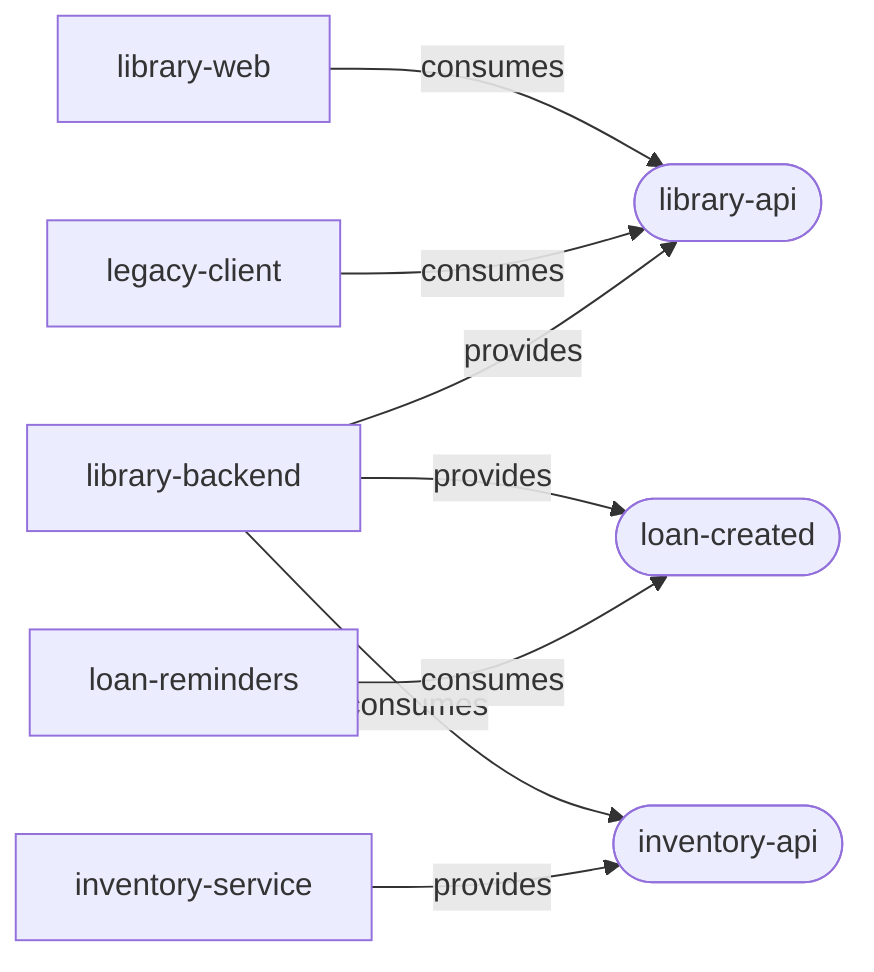

# Software catalog

## TL;DR

Every API, event, app and package has a small descriptor next to it (`catalog-info.yaml`, Backstage
format) saying what it is, which team owns it, which system it belongs to and what it provides,
consumes and depends on. A check in CI keeps the catalog from drifting from the repository.

## What pain it solves

"Who owns this API?", "who consumes this event?", "can I change this package without breaking
anyone?" are answered by asking around. Wikis that answer them go stale within weeks, because
nothing fails when they do.

## How it works

```
catalog-info.yaml                         # kind: Location, lists every descriptor below
contracts/catalog/
├── domain.yaml                           # Domain: lending
├── systems.yaml                          # Systems: library, inventory
└── teams.yaml                            # Groups: team-lending, team-inventory, team-frontend
contracts/apis/<api>/catalog-info.yaml    # kind: API, type openapi, definition ./openapi.yaml
contracts/events/<event>/catalog-info.yaml  # kind: API, type asyncapi, definition ../asyncapi.yaml
contracts/packages/<pkg>/catalog-info.yaml  # kind: Component, type library
apps/<app>/catalog-info.yaml              # kind: Component, type service or website
```

```yaml
# apps/api/catalog-info.yaml
apiVersion: backstage.io/v1alpha1
kind: Component
metadata:
  name: library-backend
  description: Implements the Library API, reserves copies in the inventory and publishes loan.created.
spec:
  type: service
  lifecycle: production
  owner: team-lending
  system: library
  providesApis: [library-api, loan-created]
  consumesApis: [inventory-api]
  dependsOn: [component:acme-api-types, component:acme-domain, ...]
```

Events are modelled the way Backstage models them: an `API` entity, provided by the producer and
consumed by the consumers.



**The check** (`pnpm nx run @acme/tools:catalog-check`, in CI) fails when:

- a descriptor is malformed: wrong `apiVersion` or `kind`, a name that is not kebab-case, no
  description, an unknown `type` or `lifecycle`;
- a reference (`owner`, `system`, `domain`, `providesApis`, `consumesApis`, `dependsOn`) points to
  an entity that does not exist, or an entity is defined twice;
- the root `Location` does not list exactly the descriptor files of the repository;
- an API's `definition` file does not exist, or the API is not provided by exactly one component;
- an OpenAPI contract, an event, an app or a package has no descriptor;
- a component's `dependsOn` differs from the `@acme/*` dependencies of its `package.json`, or a
  package's `title` is not its npm name.

The last rule is what keeps the dependency graph honest: it comes from the code, not from memory.

## Day-to-day usage

- **New API, event, app or package:** add its `catalog-info.yaml` and list it in the root
  `catalog-info.yaml`. The check tells you what is missing.
- **New dependency on an `@acme/*` package:** add it to `dependsOn`, or the check fails.
- **A team takes over an API:** change `owner`. That is the whole hand-over in the catalog.

```bash
pnpm nx run @acme/tools:catalog-check
```

## Trade-offs

- **Backstage format, no Backstage.** The descriptors follow its schema so a Backstage instance can
  register the root `catalog-info.yaml` as is. Running Backstage itself (a server, a database,
  plugins) is not worth it for a few services; a static portal generated from the same files covers
  the demo (see [next steps](./next-steps.md)).
- **Events as `asyncapi` APIs.** Backstage has no event kind; the common practice is an `API`
  entity whose definition is the AsyncAPI document (`contracts/events/asyncapi.yaml`).
- **Owners are fictional teams.** No people: the repository holds no personal data.
- Descriptors are one more file per project. The check makes forgetting one a CI failure instead of
  a silent gap.

## How to demonstrate

Remove a line from `dependsOn` in `apps/web/catalog-info.yaml` and run the check: it prints the list
the descriptor should have, taken from `package.json`.

## Frequently asked questions

**Does a descriptor change need a changeset?** No. Descriptors are not part of any published package,
and `changeset-check` ignores them.

**Why not generate the descriptors from `package.json`?** Ownership, system and lifecycle are
decisions, not facts in the code. What can be derived (dependencies, package names) is checked
instead of generated, so the descriptor stays readable on its own.
