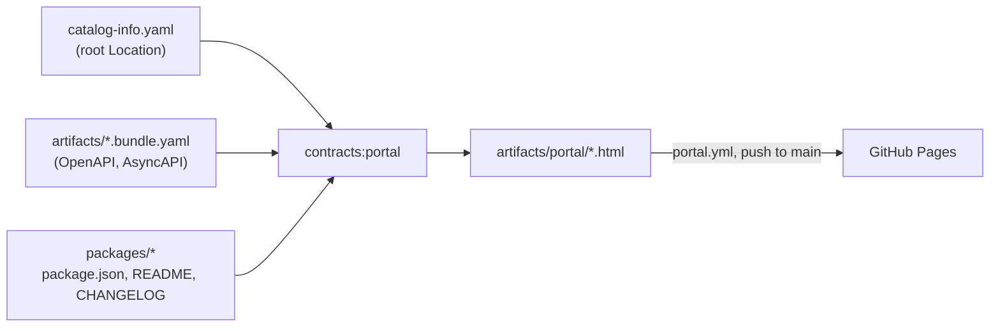

# Developer portal

## TL;DR

A static site generated from the repository: every system, API, event, service and package, with
its owner, who provides and consumes it, how to install it and an interactive reference. It is
rebuilt and published to [GitHub Pages](https://m4ciel.github.io/contract-first-poc/) on every push
to `main`, so what it shows is what is merged.

## What pain it solves

A developer who wants to use an API needs to know that it exists, who owns it, whether it is stable,
which package to install and what each operation does. Without a portal that means reading YAML in a
repository they do not know, or asking in a channel. The [software catalog](./17-software-catalog.md)
holds the facts; the portal makes them browsable by people who never clone the repository.

## How it works



`pnpm nx run contracts:portal` (`contracts/tooling/portal/`) reads the descriptors listed in the root
`catalog-info.yaml`, the bundled contracts (the same files oasdiff compares) and each package's
`package.json`, README and changelog, and writes one HTML file per page:

| Page                      | What it shows                                                                                                  |
| ------------------------- | -------------------------------------------------------------------------------------------------------------- |
| `index.html`              | Systems with their APIs and components, the provides/consumes graph, teams and what each owns                  |
| `api-<name>.html`         | Owner, lifecycle, provider, consumers, the packages to install, the operations with their stability (HTTP API) |
| `api-<name>.html` (event) | The same facts, and the AsyncAPI document rendered: channels, operations, message payloads                     |
| `reference-<name>.html`   | The interactive reference of an HTTP API (Scalar): every operation, schema and example                         |
| `component-<name>.html`   | A service or app (provides, consumes, depends on) or a package (version, generated from, README, changelog)    |

The pages are plain HTML with an inlined stylesheet (light and dark). Scalar, the AsyncAPI viewer,
Mermaid and marked come from a CDN, each pinned to an exact version with a Subresource Integrity
hash: a modified file on the CDN is refused by the browser instead of being run.

**Publishing.** `.github/workflows/portal.yml` runs on every push to `main` (and on demand): it runs
`catalog-check` first, builds the portal and deploys it with the official Pages actions. The build
job can only read; only the deploy job may write to Pages, in the `github-pages` environment.

## Day-to-day usage

- **Looking for an API:** open the portal, pick the system, open the API. Owner, consumers and the
  install command are at the top; the reference is one click away.
- **Changing an API:** check "Consumed by" first; those are the teams a breaking proposal concerns.
- **Adding an API, event, app or package:** add its descriptor (see the
  [catalog](./17-software-catalog.md)); the portal picks it up on the next merge. Nothing to edit in
  the portal itself.
- **Previewing locally:**

```bash
pnpm nx run contracts:portal
open contracts/artifacts/portal/index.html   # xdg-open on Linux
```

## Trade-offs

- **Static, not Backstage.** No server, no database, no plugins to maintain; about 650 lines of
  TypeScript, the core at 100% test coverage. The cost: no search, no plugins (CI status, on-call, costs), and
  nothing outside this repository. The descriptors are Backstage's format, so moving to Backstage
  later means registering one file, not rewriting the catalog
  ([ADR 0014](./adr/0014-static-portal-on-github-pages.md)).
- **Public by construction.** GitHub Pages serves this portal to anyone, which is fine here because
  it shows only what the public repository already contains. A company portal for internal APIs
  would need a private host (Pages with access control, or an internal bucket behind SSO).
- **Shows `main`, not releases.** The package version shown is the one in `package.json` on `main`;
  a consumer pinned to an older release reads that release's README in the registry.
- **CDN at view time.** The pages need the CDN to render the reference and diagrams; SRI keeps that
  safe, not offline.

## How to demonstrate

[Demo 12](../demos/12-developer-portal.sh) builds the portal, follows a developer from the home page
to the Library API (owner, consumers, install command, reference, package page), then shows that a
descriptor drifting from `package.json` fails before anything is published, and that handing an API
to another team is a one-line change the portal follows.

```bash
bash demos/12-developer-portal.sh
```

## Frequently asked questions

**Can a page be edited by hand?** No: `contracts/artifacts/` is generated and not committed. Change
the descriptor, the contract or the package README, and the next build shows it.

**What if the catalog is wrong?** `catalog-check` runs before the build, in CI and in the publishing
workflow. A wrong catalog fails the pull request and is never deployed.

**Does the portal need a changeset?** No. It is not a package, and `changeset-check` ignores its
sources (descriptors, the portal tooling and Markdown files). The portal shows a package README as
soon as it is merged; the registry gets it with the package's next release.
