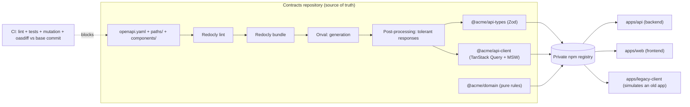

# Showcase: contract-first architecture with generated packages

> **About this file:** this is the original brief that drove the proof of concept, translated from
> Portuguese. It is kept verbatim (apart from the translation) to show the spec-driven process.
> Where the implementation deliberately deviates from it (for example Nx, NestJS, Jest, local AWS
> with MiniStack, and English-only documentation), the decision and its reason are recorded in
> [`docs/adr/`](./adr/).

> **For the agent reading this file:** this document is the complete specification of a POC. Your
> job is to build a **generic** project that demonstrates the architecture described here and to
> write, inside it, a `docs/` area that explains each part: why it exists, what pain it solves, how
> it works, trade-offs and how to demonstrate it live. The POC will be used in a KT (knowledge
> transfer) session for an engineering team.
>
> Read the whole document before starting. Sections 12 to 15 say exactly what to deliver.

---

## 0. Mandatory constraints

- **Compliance:** the project must be 100% generic. Do not use names of companies, products, real
  business domains, internal URLs or people. The example domain is a **fictional library**
  (`books`, `loans`), described in section 3. Use `@acme` as the npm scope.
- **No personal data** in fixtures, mocks, OpenAPI examples or logs: no national ID numbers,
  emails, real names or phone numbers. Mocks use obviously fake or generated values (UUIDs,
  `Book title 1`).
- **Language:** code, names, paths, scripts, commits and code comments in **English**. The
  documentation in `docs/` and the presentation README in **Brazilian Portuguese**, because the KT
  audience is Brazilian.
- **Conventions:** camelCase for functions, variables and `operationId`; PascalCase for types;
  kebab-case for paths and files.
- **Versions:** use the current stable versions of each tool and **pin exact versions** (no `^`
  or `~`) in `package.json`. Pin GitHub Actions by commit SHA.
- **Small commits** using Conventional Commits (`feat(contract): ...`, `ci: ...`, `docs: ...`).
  Validate each step before moving on.
- Generated files are **never** committed nor edited by hand.

---

## 1. Context: the problem we are solving

Today the team already does **API-first**, but only partially:

- there is an `openapi.yaml`, but it is only documentation;
- each repository (backend, web, mobile, BFF) **rewrites by hand** its own types, validation
  schemas, HTTP clients and mocks;
- there is no automated check that a change to the YAML breaks existing clients.

### Concrete pains (use them in the presentation)

| Pain                        | Day-to-day symptom                                                                                                          |
| --------------------------- | --------------------------------------------------------------------------------------------------------------------------- |
| **Contract drift**          | The YAML says `string`, the backend returns `number`, the frontend typed `string \| null`. Nobody notices until production. |
| **Duplicated work**         | N repositories writing the same types and validations, with N chances to get it wrong.                                      |
| **Silent client breakage**  | Renaming a field or adding an enum value takes down the old mobile app that is still installed.                             |
| **Front blocked by back**   | The frontend waits for the endpoint to exist in staging before starting. Manual mocks go stale.                             |
| **Inconsistent validation** | One repository validates with Zod, another with Joi, another does not validate.                                             |
| **Heterogeneous errors**    | Each service invents its own error format.                                                                                  |
| **Informal versioning**     | "Which API version does app 3.2 use?" Nobody knows.                                                                         |

### The proposal in one sentence

**The OpenAPI contract becomes code.** A single repository holds the contract and, from it,
**generates and publishes versioned packages** (types + validation, HTTP client, mocks). CI tools
**block incompatible changes by machine**. All consumers install the packages instead of rewriting
them.

---

## 2. Architecture overview



### The three published packages

| Package            | Content                                                                           | Consumed by          | Versioning                    |
| ------------------ | --------------------------------------------------------------------------------- | -------------------- | ----------------------------- |
| `@acme/api-types`  | Generated **Zod** schemas (runtime validation + inferred TS types)                | Backend and frontend | Fixed group with `api-client` |
| `@acme/api-client` | Generated **TanStack Query** hooks + **MSW** handlers in `@acme/api-client/mocks` | Frontends            | Fixed group with `api-types`  |
| `@acme/domain`     | Pure, shared domain rules (functions without I/O)                                 | Backend and frontend | Independent                   |

**Why `api-types` and `api-client` are versioned together:** the client imports the schemas from
the types package. Mismatched versions produce incompatible types. Changesets `fixed` guarantees
the same version number.

**Why `domain` is independent:** business rules change at a different pace than the HTTP
contract. Coupling the versions would force fake releases.

---

## 3. Fictional domain of the POC (library)

Keep the domain **small**. The focus is the architecture, not the business.

### `/v1` endpoints (stable)

| Method | Path                 | operationId  | Notes                                                |
| ------ | -------------------- | ------------ | ---------------------------------------------------- |
| GET    | `/v1/health`         | `getHealth`  | `{ status: 'ok' }`; 503 with Problem Details         |
| GET    | `/v1/books`          | `listBooks`  | Cursor pagination (`cursor`, `limit`)                |
| GET    | `/v1/books/{bookId}` | `getBook`    | 404 with Problem Details                             |
| POST   | `/v1/loans`          | `createLoan` | Strict body: `{ bookId }`; 201                       |
| GET    | `/v1/loans/{loanId}` | `getLoan`    | Has a `status` enum: `active`, `returned`, `overdue` |

`Book` v1: `id` (uuid), `title`, `author` (**string**), `publishedAt` (date-time with timezone),
`createdAt`.

### `/v2` endpoint in preview (to demonstrate stability levels)

| Method | Path        | operationId   | Stability |
| ------ | ----------- | ------------- | --------- |
| GET    | `/v2/books` | `listBooksV2` | `alpha`   |

`Book` v2: `author: string` becomes `authors: string[]`. This is an **incompatible** change, which
is why it lives in `/v2`, and it is born `alpha` so it can be adjusted freely during the sprint.

### `@acme/domain`

One or two pure functions, with 100% coverage and mutation score. Suggestions:

- `calculateDueDate(loanStartedAt: Date, policy: LoanPolicy): Date`
- `isLoanOverdue(dueAt: Date, now: Date): boolean`

The idea is to show that the backend and the frontend use **the same rule**, without
reimplementing it.

---

## 4. Repository structure of the POC

For the demo to be self-contained, use **a monorepo** with the contracts repository and example
consumers side by side. In real life, `contracts/` would be its own repository and the apps would
consume from the registry. Make this explicit in the documentation.

```
contract-first-poc/
├── AGENTS.md                      # rules for AI agents (source)
├── CLAUDE.md                      # contains only "@AGENTS.md" (import)
├── README.md                      # KT entry point
├── docs/                          # see section 13
├── contracts/                     # the "contracts repository"
│   ├── openapi.yaml               # root: info + $ref to paths and schemas
│   ├── paths/                     # one file per path (kebab-case)
│   ├── components/schemas/        # reusable schemas
│   ├── events/                    # event catalog (README + 1 example)
│   ├── redocly.yaml
│   ├── orval.config.ts
│   ├── scripts/                   # post-processing + tests
│   ├── .changeset/
│   └── packages/
│       ├── api-types/
│       ├── api-client/
│       └── domain/
├── apps/
│   ├── api/                       # minimal backend (Fastify or Hono) using api-types
│   ├── web/                       # React + TanStack Query using api-client and MSW mocks
│   └── legacy-client/             # script/test that simulates an old app
├── demos/                         # live demo scripts (section 14)
└── .github/workflows/
    ├── ci.yml
    ├── changeset-version.yml
    ├── release.yml
    └── preview.yml
```

Tools: **pnpm workspaces**, current Node.js LTS, strict TypeScript with a shared
`tsconfig.base.json`, ESLint, Prettier, Vitest and Stryker.

---

## 5. Piece by piece: what it is, what pain it solves, how it works

Each subsection below must become **one document in `docs/`** using the format of section 13.

### 5.1 OpenAPI as the single source of truth

- **Pain:** drift between the YAML, the backend and the frontends.
- **How:** `openapi.yaml` (OpenAPI 3.1) is the only place where the API shape is defined. Paths
  live in `paths/`, reusable schemas in `components/schemas/`, and the root only does `$ref`.
  Small files produce reviewable diffs.
- **Mandatory contract conventions:**
  - every route starts with a major version: `/v1`, `/v2`, ...;
  - `operationId` is required, unique and camelCase (it becomes the generated function name);
  - kebab-case paths and plural nouns;
  - errors as **RFC 9457 Problem Details** (`application/problem+json`, with `type`, `title`,
    `status`, `detail`, `instance`; `additionalProperties: true`);
  - **cursor pagination**, not offset (stable under inserts, scales better);
  - **UUID** IDs; dates in **ISO 8601 with timezone** (`format: date-time`);
  - `x-stability-level` required on every operation (see 5.8);
  - examples without personal data.

### 5.2 Redocly: lint and bundle

- **Pain:** conventions that only exist in the wiki and nobody follows.
- **How:** `redocly.yaml` extends `recommended` and adds custom rules:
  - `operation-operationId` and `operation-operationId-unique` as errors;
  - `paths-kebab-case` as error;
  - `path-segment-plural` as error, with exceptions for version segments (`v1`, `v2`) and
    `health`;
  - configurable rule `rule/operation-id-camel-case` (assertion `casing: camelCase` on
    `Operation.operationId`);
  - configurable rule `rule/versioned-paths` (assertion `pattern: /^\/v[1-9][0-9]*(?:\/|$)/` on
    the `Paths` subject);
  - configurable rule `rule/operation-stability-level` (`defined: true` +
    `enum: [draft, alpha, beta, stable]` on `Operation.x-stability-level`).
- `redocly bundle` produces `artifacts/openapi.bundle.yaml` (git-ignored), a single file that
  feeds the generator and oasdiff.
- **Demo:** create a `/books` route without a version, or an `operationId` in snake_case, and show
  the lint failing.

### 5.3 Orval: code generation

- **Pain:** types, validations, clients and mocks written by hand in each repository.
- **How:** a single `orval.config.ts` reads the bundle and generates:
  - **Zod** schemas in `packages/api-types/src/generated/` (`type: 'zod'`);
  - a **TanStack Query v5** client with `httpClient: 'fetch'` in
    `packages/api-client/src/generated/client.ts` (`mode: 'single'`);
  - **MSW** handlers (`mock.generators: [{ type: 'msw' }]`), exported from
    `@acme/api-client/mocks`.
- Zod configuration: `strict` on for `param`, `query`, `header` and `body` (**strict requests**)
  and **off for `response`**. Use `generateReusableSchemas: false`,
  `fetch.runtimeValidation: false` and `clean: true`.
- Each package's `src/index.ts` only re-exports `./generated/...`.
- `src/generated/` is in `.gitignore`. Generated code is a build artifact, like `dist/`.

### 5.4 Post-processing: strict requests, tolerant responses

This is the subtlest and most valuable piece. Give it the most polished document.

- **Pain:** an old client (for example a mobile app the user has not updated in months) breaks
  when the backend:
  1. adds a **new field** to the response (if the schema is strict), or
  2. adds a **new value to an enum** (`status: 'lost'`, which the client does not know).
- **Principle:** Postel's law. Be strict in what you send (request) and tolerant in what you
  receive (response).
- **How:** a script runs **after** Orval and changes **only the response schemas**:
  1. it reads the generated client and, using the **TypeScript compiler API (AST, not regex)**,
     finds the response types: type aliases with a `data` property, collecting the
     `TypeReference`s inside it, ignoring `Array` and stripping the `Output` suffix; it also
     includes `ProblemDetails`;
  2. in the `*.zod.ts` files, inside the exported declarations whose names are in that set:
     - replaces `z.strictObject` and `z.looseObject` with `z.object`, which accepts and drops
       extra fields;
     - for every string `z.enum([...])` without `.catch` yet: appends `'unknown'` to the list (if
       missing) and chains `.catch('unknown')`.
  3. applies the edits back to front so positions are not invalidated.
- **Result:** the old client receives `status: 'unknown'` instead of a parse error, and the UI
  shows a neutral state.
- Separate the logic (`*-core.ts`, pure and tested) from the runner that reads and writes files.
  The core counts toward coverage.
- **Trade-off:** the script depends on the shape of Orval's output. An Orval upgrade may require
  an adjustment, and the core tests detect that.
- **Demo:** see section 14, scenario 3.

### 5.5 `@acme/domain`: shared rules with maximum quality

- **Pain:** the same business rule implemented in three places, with three behaviours.
- **How:** a package of **pure** functions (no I/O, no framework). Requirements:
  - 100% line, branch, function and statement coverage;
  - **mutation testing with Stryker** and `thresholds.break: 100`.
- **Why mutation:** coverage tells you the line ran, not that the test would catch a bug in it.
  Stryker changes the code (swaps `>` for `>=`, `true` for `false`) and requires some test to
  fail. Equivalent mutants, which do not change behaviour, are disabled with
  `// Stryker disable next-line <mutator>: <reason>`, visible in review.
- Minimum global coverage of 80% for everything else, excluding generated code and configuration
  boilerplate.

### 5.6 CI and compatibility with oasdiff

- **Pain:** "does this change break anyone?" is answered by intuition.
- **How:** the `ci.yml` workflow runs on PRs and on pushes to `main`:
  1. `format:check`, ESLint, `contract:lint`;
  2. `generate` (bundle + Orval + post-processing);
  3. tests with coverage, 100% domain coverage, domain mutation testing;
  4. typecheck;
  5. **oasdiff `breaking`** comparing the PR bundle with the bundle of the **exact base commit**
     (`github.event.pull_request.base.sha`, or `github.event.before` on push). The base contract
     is extracted with `git archive <sha> openapi.yaml paths components` and bundled on the fly.
  6. on the first contract commit there is no base: the step is skipped with an explicit message.
- Download the oasdiff binary at a pinned version and **verify its SHA-256 checksum**.
- **Golden rule:** never weaken the check to make a PR pass. If it broke, the change goes to `/v2`
  or to a new operation.
- **Why the exact base commit:** comparing with the current `main` would produce false positives
  or negatives when `main` moves during the PR.

### 5.7 Versioning and release with Changesets

- **Pain:** manual releases, no changelog, inconsistent versions.
- **How:**
  - whoever changes something publishable runs `pnpm changeset` and picks patch, minor or major
    with a description;
  - `.changeset/config.json` sets `fixed: [["@acme/api-types", "@acme/api-client"]]`,
    `access: restricted` and `commit: false`;
  - `changeset-version.yml`: on every push to `main`, the Changesets action opens or updates a
    **"Version PR"** with bumps and CHANGELOG;
  - `release.yml`: **only `workflow_dispatch` on `main`**. Generates, tests, typechecks, builds
    and runs `changeset publish`. Nothing is published automatically.
- **Registry in the POC:** use a disposable local registry (for example **Verdaccio** via Docker
  Compose) to demonstrate publishing and dist-tags without depending on corporate infrastructure.
  Document that, in production, it would be the company's private registry.

### 5.8 Stability levels and preview packages

This part answers the main agile objection: **"contract-first makes the flow rigid"**.

- **Pain:** the tech lead wants the contract ready **before the sprint**, but the contract will
  still change during implementation. If it is treated as stable, every adjustment becomes a
  blocked breaking change. If it is published as a normal version, it leaks into production.
- **How:**
  1. every operation declares `x-stability-level`: `draft`, `alpha`, `beta` or `stable`;
  2. **oasdiff understands this field natively**:
     - in `draft` and `alpha`, incompatible changes are allowed;
     - `beta` and `stable` are protected;
     - **downgrading** the level (for example from `stable` to `beta`) is blocked.
     - **Verify this behaviour in the POC** with a real test and document the result; it is part
       of the demo;
  3. **preview publishing** (`preview.yml`, `workflow_dispatch` on `main` only):
     - `changeset version --snapshot preview` produces versions such as
       `0.2.0-preview-20261105185450`. Configure `snapshot.useCalculatedVersion: true` and
       `snapshot.prereleaseTemplate: "{tag}-{datetime}"`;
     - a **guard** fails the job if no `-preview-` version was produced. Without pending
       changesets, `publish` would publish the normal version under the `preview` tag;
     - `changeset publish --tag preview --no-git-tag`: the **`latest`** dist-tag never changes;
     - `release.yml` and `preview.yml` share a `concurrency` group so they never publish at the
       same time;
  4. **production protection** lives in the consumers: operations below `stable` stay behind
     **feature flags** in the backend (404 in production) and in the app;
  5. **promotion:** a PR changes the level to `stable` and a normal release is made. From then
     on, oasdiff protects the operation forever.
- **Why snapshot and not Changesets "pre mode":** pre mode puts the whole `main` into prerelease
  mode (`pre.json`), which conflicts with trunk-based development. Snapshots are ephemeral: they
  change nothing that is committed.
- **Important clarification:** preview is not the same as `/v2`. A **new** endpoint can be born
  in `/v1` as `alpha`, because adding an endpoint breaks nobody. `/v2` is only needed to break
  something that is already `stable`.

### 5.9 Compatibility rules (governance)

- In `/v1`, only **additive** changes: new optional response field, new endpoint, new enum value
  (covered by the fallback), new optional parameter.
- **Never** change the meaning of a field. Mark it `deprecated: true`, add a replacement and
  remove the old one only in the next major version.
- A new **required request** field is breaking.
- Reserve `426 Upgrade Required` with Problem Details as a future minimum-app-version mechanism.
  Document it, but do not implement it in the POC.

### 5.10 Domain event catalog

- **Pain:** asynchronous events (queues, webhooks) suffer the same drift as the HTTP API, only
  more silently.
- **How:** an `events/` folder with names `entity.action.vN` (for example `loan.created.v1`).
  Events are **immutable**: if the shape changes, a `v2` is born. No personal data without
  pseudonymisation.
- In the POC, create **one** example event with JSON Schema and document that the natural next
  step would be AsyncAPI with validation in CI. Make it explicit that this part has no automated
  validation yet.

### 5.11 Rules for AI agents (AGENTS.md)

- **Pain:** AI agents (Claude Code, Copilot, Cursor) "invent" endpoints, edit generated code or
  weaken checks to make CI pass.
- **How:**
  - `AGENTS.md` at the root is the source of the repository rules: source of truth, tools,
    compatibility, workflow, prohibitions (do not edit generated files, do not add endpoints
    without approval, do not publish without an explicit request);
  - `CLAUDE.md` contains only `@AGENTS.md`, Claude Code's import syntax, to guarantee it reads
    the same file;
  - a single file serves several agents.

---

## 6. Workflow with trunk-based development

```mermaid
sequenceDiagram
  participant TL as Tech Lead / Staff
  participant C as Contracts repo
  participant CI as CI (oasdiff etc.)
  participant R as Registry
  participant Dev as Devs (back and front)

  TL->>C: PR with new contract (x-stability-level: alpha) + changeset
  C->>CI: lint, generation, tests, oasdiff
  CI-->>C: green (alpha may change)
  TL->>C: merge to main
  TL->>R: triggers "Publish Preview" → 0.2.0-preview-…  (preview tag)
  Dev->>R: pnpm add @acme/api-client@preview
  Dev->>Dev: back implements behind a feature flag; front uses MSW
  TL->>C: contract adjustments during the sprint (allowed in alpha)
  TL->>R: new preview
  TL->>C: PR promoting to stable
  C->>CI: oasdiff starts protecting the operation
  TL->>R: triggers "Publish Packages" → 0.2.0 (latest tag)
  Dev->>Dev: removes the flag, upgrades to the stable version
```

Points to highlight in the presentation:

- the contract is ready **before** the sprint and unblocks back and front in parallel;
- the frontend starts on day 1 with **generated MSW mocks**, without waiting for the backend;
- the contract PR review is an **API design conversation** before any code exists, which is the
  cheapest phase to change things.

---

## 7. Advantages and disadvantages in agile environments

### Advantages

- Frontend and backend in parallel from the start of the sprint.
- API review happens before code.
- Machine-guaranteed compatibility enables frequent deploys without fear.
- Automatic changelog communicates changes between squads.
- Faster onboarding: the contract is executable documentation.

### Disadvantages and mitigations

| Disadvantage                                                                | Mitigation                                                 |
| --------------------------------------------------------------------------- | ---------------------------------------------------------- |
| Longer cycle for small changes (contract PR, release, bump, implementation) | Snapshot previews; `workspace:` during local development   |
| Approval bottleneck on the TL                                               | Stability levels: `alpha` gives freedom without risk       |
| Rigidity: a wrong name in `stable` lasts until the next major version       | Be born `alpha`; promote only after real use               |
| Heavier CI (mutation, generation)                                           | Run Stryker only when the domain package changes; caching  |
| Coupling to the shape of Orval's output                                     | Tests for the post-processing script; pinned Orval version |

### When it is not worth it

- An internal API with a single consumer that is deployed together with the backend.
- Throwaway prototypes.
- Very small teams where the release overhead outweighs the gain. In that case, start with levels
  1 and 2 of the maturity model below.

---

## 8. Incremental adoption model (from today to the full picture)

The team is at **level 0** today. Show that it is possible to climb one step at a time, and that
each step delivers value on its own.

| Level | What is adopted                                             | Pain it solves                        |
| ----- | ----------------------------------------------------------- | ------------------------------------- |
| 0     | YAML as documentation; each repository writes its schemas   | (current situation)                   |
| 1     | YAML centralised in one repository + **Redocly lint** in CI | Conventions become rules              |
| 2     | **Types/Zod generation** published as a package             | End of drift and duplication          |
| 3     | Generated **client + MSW mocks**                            | Frontend unblocked from the backend   |
| 4     | **oasdiff** against the base commit                         | End of silent breakage                |
| 5     | Tolerant responses + `unknown` fallback                     | Old clients survive additive changes  |
| 6     | **Changesets** + controlled manual release                  | Reliable versioning and changelog     |
| 7     | **Stability levels + previews**                             | Agility without losing safety         |
| 8     | Domain package with mutation testing + event catalog        | Rules and events with the same rigour |

---

## 9. Known gotchas (document in the FAQ)

- **Node version:** `pnpm` or corepack break when the local Node is older than required. Use
  `.nvmrc` and `engines`, and document `nvm use`.
- **Post-processing coupled to Orval:** when upgrading Orval, run the core tests and inspect the
  output.
- **Snapshot without a changeset:** without the guard, the normal version would be published
  under the `preview` tag.
- **oasdiff and `x-stability-level`:** confirm with a real test that `alpha` allows breaking
  changes and that downgrading the level is blocked.
- **First contract commit:** there is no base to compare with, and the oasdiff step must skip
  with a clear message.
- **Equivalent mutants:** disable them case by case with a justification, never lower the
  threshold.
- **`workspace:*` and publishing:** pnpm converts it to the real version on publish. Test this in
  Verdaccio.

---

## 10. Reference configuration files

Use these as a base (adjust versions and scope):

**`orval.config.ts`**

```ts
import { defineConfig } from 'orval';

export default defineConfig({
  acme: {
    input: { target: './artifacts/openapi.bundle.yaml' },
    output: {
      target: './packages/api-client/src/generated/client.ts',
      schemas: {
        path: './packages/api-types/src/generated',
        type: 'zod',
        importPath: '@acme/api-types',
      },
      mode: 'single',
      client: 'react-query',
      httpClient: 'fetch',
      tsconfig: './packages/api-client/tsconfig.json',
      mock: { generators: [{ type: 'msw' }] },
      override: {
        zod: {
          generateReusableSchemas: false,
          strict: { param: true, query: true, header: true, body: true, response: false },
        },
        fetch: { runtimeValidation: false },
        query: { version: 5 },
      },
      clean: true,
      formatter: 'prettier',
    },
  },
});
```

**Root scripts (`package.json`)**

```json
{
  "contract:lint": "redocly lint openapi.yaml",
  "contract:bundle": "redocly bundle openapi.yaml --output artifacts/openapi.bundle.yaml",
  "generate": "pnpm contract:bundle && orval --config orval.config.ts && node --experimental-strip-types scripts/apply-response-enum-fallback.ts",
  "release:version": "changeset version",
  "release:publish": "changeset publish",
  "release:preview:version": "changeset version --snapshot preview",
  "release:preview:publish": "changeset publish --tag preview --no-git-tag"
}
```

**Snapshot guard in `preview.yml`**

```yaml
- name: Require snapshot versions
  run: |
    set -euo pipefail
    if ! grep --quiet --extended-regexp '"version": "[^"]+-preview-[0-9]+"' packages/*/package.json; then
      echo "No pending changesets produced a preview version; nothing to publish."
      exit 1
    fi
```

**CI comparison against the exact base commit**

```bash
BASE_SHA="${{ github.event.pull_request.base.sha || github.event.before }}"
if [[ -z "$BASE_SHA" ]] || ! git cat-file -e "${BASE_SHA}:openapi.yaml" 2>/dev/null; then
  echo "No base contract; skipping first-contract compatibility check."; exit 0
fi
git archive "$BASE_SHA" openapi.yaml paths components | tar -x -C "$BASE_DIR"
redocly bundle "$BASE_DIR/openapi.yaml" --output base.bundle.yaml
oasdiff breaking base.bundle.yaml artifacts/openapi.bundle.yaml
```

> In the POC the contract lives in `contracts/`. Adjust the `git archive` paths and use
> `working-directory` in the steps.

---

## 11. Example consumers (`apps/`)

- **`apps/api`:** minimal backend (Fastify or Hono, in memory, no database).
  - Validates requests with the Zod schemas from `@acme/api-types` and responds with Problem
    Details on errors.
  - Implements `/v1` and `/v2/books` behind a feature flag (`FEATURE_BOOKS_V2=true`); without the
    flag, it returns 404.
  - Uses `@acme/domain` for `isLoanOverdue`.
- **`apps/web`:** React + Vite using the generated hooks.
  - `VITE_USE_MOCKS=true` mode turns on MSW with the handlers from `@acme/api-client/mocks`,
    showing the frontend working **without a backend**.
  - Renders `status: 'unknown'` as a neutral badge.
- **`apps/legacy-client`:** a Vitest test that **freezes** a copy of the schemas of an old version
  and proves that:
  1. a response with an extra field is accepted;
  2. a response with a new enum value becomes `'unknown'` instead of throwing;
  3. in contrast, a strict schema (without post-processing) **would break** in both cases.

---

## 12. Acceptance criteria

- [ ] `pnpm install && pnpm generate && pnpm test` work from scratch on a clean clone.
- [ ] `contract:lint` passes, and fails in the cases shown in the demos.
- [ ] Global coverage ≥ 80%; `domain` with 100% coverage and mutation score 100.
- [ ] Post-processing script tests cover: replacing `strictObject`/`looseObject`, enum without
      `'unknown'`, enum that already has `'unknown'`, enum that already has `.catch`, request
      schema **not** changed.
- [ ] Workflows `ci.yml`, `changeset-version.yml`, `release.yml` and `preview.yml` present, with
      actions pinned by SHA.
- [ ] `docker compose up` starts Verdaccio, and a script publishes a release and a preview
      locally, showing the `latest` and `preview` dist-tags.
- [ ] Each scenario in section 14 has a script in `demos/` and a step by step in the docs.
- [ ] No generated file committed; `.gitignore` covers `src/generated/`, `artifacts/`, `dist/`,
      `coverage/` and `reports/`.
- [ ] No personal data, company name or real domain in any file.

---

## 13. Documentation area (`docs/`)

Write for engineers of several levels. Each piece document follows **the same template**:

```markdown
# <Piece name>

## TL;DR

One or two sentences.

## What pain it solves

A concrete "before" situation, with an example.

## How it works

Explanation + diagram (Mermaid) when it helps + a real code/config excerpt from the repository.

## Day-to-day usage

Commands and steps.

## Trade-offs

What it costs, when not to use it, alternatives considered and why they were not chosen.

## How to demonstrate

Reproducible step by step (link to the script in demos/).

## Frequently asked questions
```

Suggested structure:

```
docs/
├── 00-overview.md                  # problem, proposal, diagram, glossary
├── 01-openapi-contract.md          # 5.1 + conventions
├── 02-lint-and-bundle.md           # 5.2
├── 03-code-generation.md           # 5.3
├── 04-tolerant-responses.md        # 5.4 (the most detailed one)
├── 05-domain-package.md            # 5.5 + mutation testing explained
├── 06-ci-and-compatibility.md      # 5.6
├── 07-versioning-and-release.md    # 5.7
├── 08-stability-and-preview.md     # 5.8 + the flow from section 6
├── 09-compatibility-rules.md       # 5.9 (table: additive vs breaking, with examples)
├── 10-events.md                    # 5.10
├── 11-ai-agents.md                 # 5.11
├── 12-agile-and-trade-offs.md      # section 7
├── 13-incremental-adoption.md      # section 8 (what we would bring to our scenario)
├── 14-faq-and-gotchas.md           # section 9 + common objections
└── adr/                            # one short ADR per decision (context, decision, consequences)
    ├── 0001-contract-first-with-generated-packages.md
    ├── 0002-strict-zod-requests-tolerant-responses.md
    ├── 0003-oasdiff-against-base-commit.md
    ├── 0004-changesets-with-manual-publishing.md
    └── 0005-snapshot-instead-of-pre-mode.md
```

`09-compatibility-rules.md` must have a **"change → is it breaking? → what to do"** table covering
at least: adding an optional response field, adding a required request field, removing a field,
renaming a field, changing a type, adding an enum value to a response, adding an enum value to a
request, making a response field optional, adding an endpoint, changing a status code.

`14-faq-and-gotchas.md` must answer objections the team will probably raise:

- "Doesn't this make everything slower?"
- "What if I need to change something urgently?"
- "Why not generate directly in each repository?"
- "Why Zod and not just TS types?"
- "Why not GraphQL or tRPC?"
- "Who owns the contracts repository?"
- "What about services in other languages?" (the contract is still the source; per-language
  generators, and oasdiff works for all of them)

---

## 14. Live demo script

Each scenario becomes a script in `demos/` (which creates a branch, applies the change and runs
the checks) and a section in the corresponding doc. Target time: about 3 minutes each.

1. **Convention blocked:** add `/books` without a version or an `operationId` `list_books`.
   Redocly fails.
2. **Additive change:** add an optional `isbn` to `Book`. oasdiff passes, and the old frontend
   keeps working.
3. **A new enum value does not take down an old client:** add `lost` to `Loan.status`. The
   `legacy-client` test shows `'unknown'`; the version without post-processing throws a
   `ZodError`.
4. **Breaking change blocked:** rename `author` to `writer` in `/v1`. oasdiff fails, and the right
   path is shown (deprecate and add a new field, or `/v2`).
5. **Preview in alpha:** freely change `/v2/books` (`alpha`). oasdiff passes. Publish a preview to
   Verdaccio and show `npm dist-tag ls` with `latest` untouched.
6. **Promotion and protection:** promote `/v2/books` to `stable`, make a new incompatible change
   and watch oasdiff fail. Try to downgrade to `beta` and watch it fail too.
7. **Frontend without a backend:** `apps/web` with `VITE_USE_MOCKS=true` and the backend off.
8. **Strict request:** send `POST /v1/loans` with an extra field. The backend rejects it with a
   400 Problem Details.
9. **Mutation testing:** introduce a weak test in `domain` (one that does not check the boundary)
   and watch Stryker point out the surviving mutant.

---

## 15. Extra deliverables

- **Root `README.md`** as the KT entry point: the problem in 5 lines, diagram, "run it in 5
  minutes", links to `docs/` and to the demo script.
- **`docs/presentation.md`:** slide script (title + 3 to 5 bullets per slide) for about 40
  minutes:
  1. current pains;
  2. the proposal;
  3. architecture;
  4. demos 3, 4 and 5;
  5. agile flow;
  6. trade-offs;
  7. incremental adoption;
  8. next steps.
- **`docs/glossary.md`:** contract-first, API-first, bundle, breaking change, dist-tag, snapshot,
  mutant, Problem Details, cursor, trunk-based, feature flag.
- **`docs/next-steps.md`:**
  - AsyncAPI for events;
  - generators for other languages;
  - publishing the bundle as an artifact;
  - documentation portal (Redocly/Scalar) generated from the bundle;
  - `426 Upgrade Required` for minimum app version;
  - contract tests in the backend validating real responses against the schemas.

When you are done, run all the checks, list what was validated and what was not (for example,
GitHub workflows that only run in CI), and point out any deviation from this specification with
its reason.
